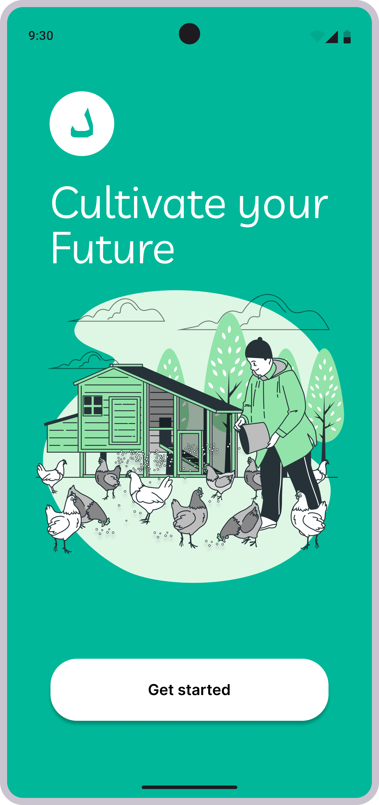
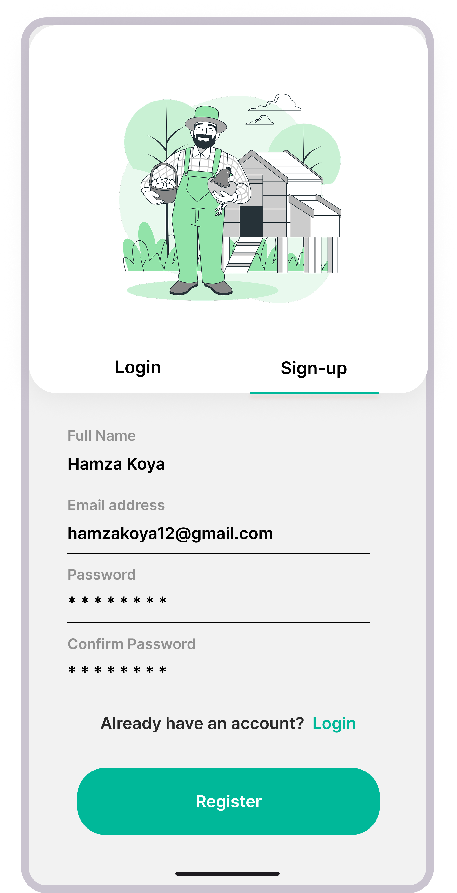
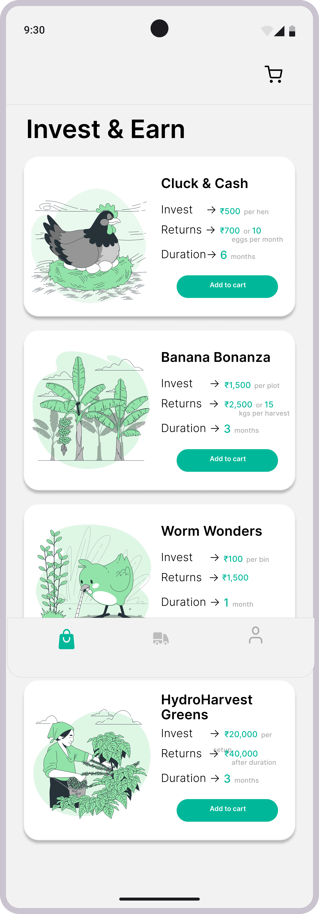

# 🌱 Darra Farming

**Cultivate your future.** Darra Farming is a Flutter mobile app that lets users invest in small-scale farming businesses, from poultry to bananas to vermicomposting, and track what they earn.


> ⚠️ **Note:** This is a portfolio/demo project. All names, contact details, reviews and returns shown in the app are sample data and not real financial offers.

---

## 📱 Screenshots

| Welcome | Sign-up | Invest & Earn | Investment Details |
|:---:|:---:|:---:|:---:|
|  |  |  |  |

---

## ✨ Features

- 🔐 **Login / Sign-up:** register with name, email and password.
- 🌾 **Invest & Earn:** browse farming investment options, each showing the investment amount, expected returns and duration:
  - 🐔 **Cluck & Cash:** invest per hen, earn returns or eggs monthly
  - 🍌 **Banana Bonanza:** invest per plot, returns per harvest
  - 🪱 **Worm Wonders:** vermicomposting bins with quick turnaround
  - 🥬 **HydroHarvest Greens:** hydroponic setup investment
- 📄 **Investment details:** overview, what's involved, step-by-step how it works, provider contact info and user reviews.
- 🛒 **Cart:** add investments to a cart before checking out.
- ⚡ **Smooth navigation:** built with GetX for fast routing and reactive state.

---

## 🛠️ Tech Stack

| Technology | Purpose |
|---|---|
| **Flutter** | Cross-platform mobile UI |
| **Dart** | Programming language |
| **GetX** | State management, dependency injection, route management |

---

## 🚀 Getting Started

### Prerequisites
- [Flutter SDK](https://docs.flutter.dev/get-started/install) (3.x or later)
- Android Studio / VS Code with the Flutter extension
- An emulator or a physical device

### Run locally

```bash
# Clone the repository
git clone https://github.com/sherledge/Darra.git
cd <repo-name>

# Install dependencies
flutter pub get

# Run the app
flutter run
```

### Build an APK

```bash
flutter build apk --release
```

---

## 🗺️ Roadmap

- [ ] Backend integration (authentication and investment data)
- [ ] Payment gateway
- [ ] Order and returns tracking screen
- [ ] User profile
- [ ] Fish and egg farming options

---

## 🤝 Contributing

Suggestions and pull requests are welcome. Open an issue to discuss what you'd like to change.

## 👤 Author

**Shabeer**
